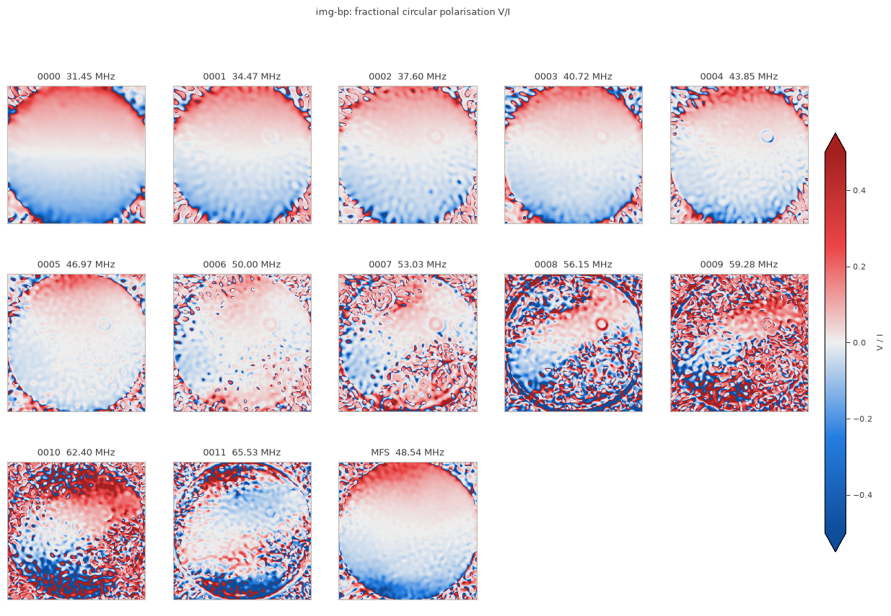
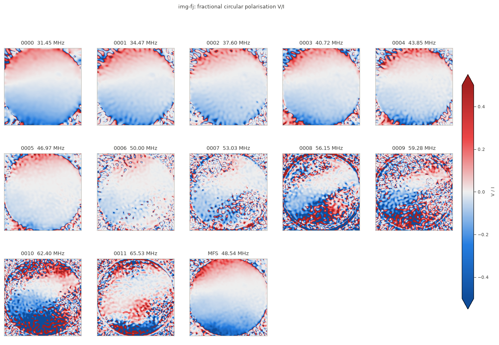
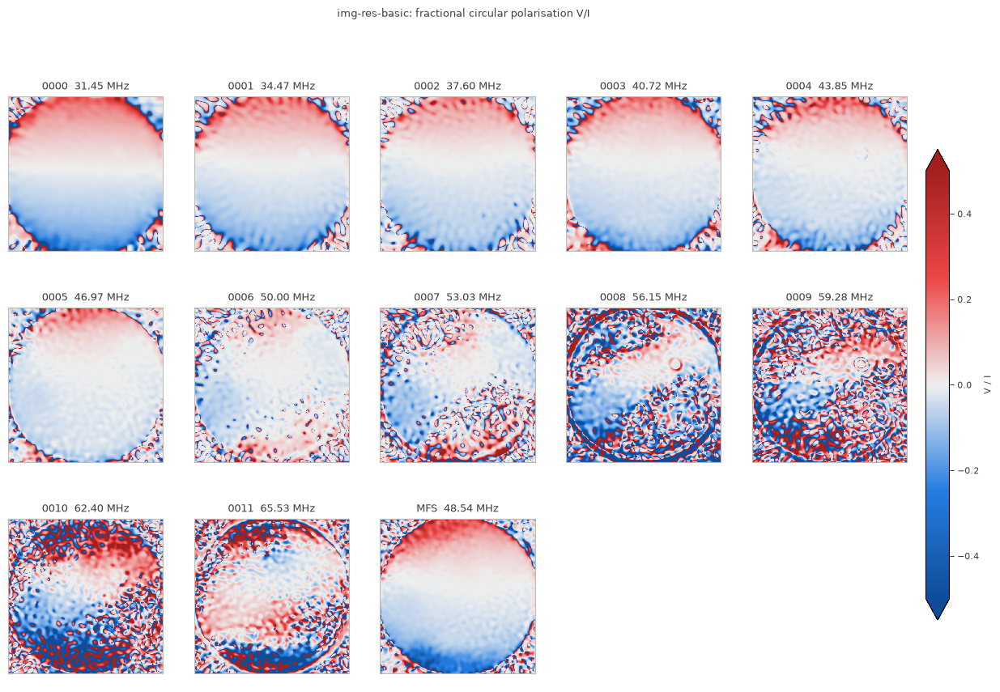
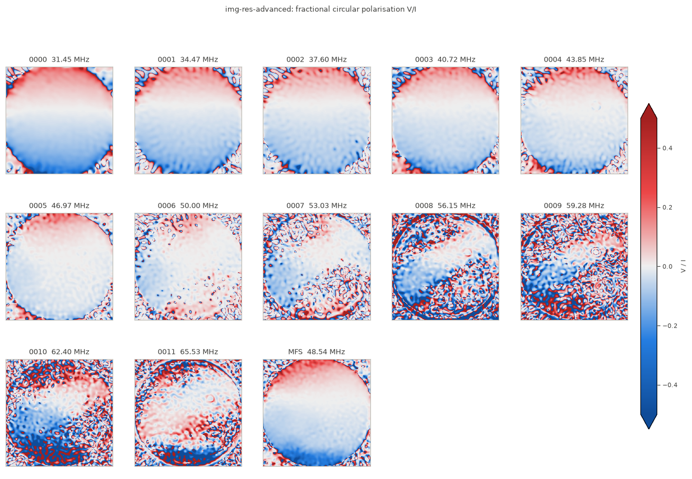
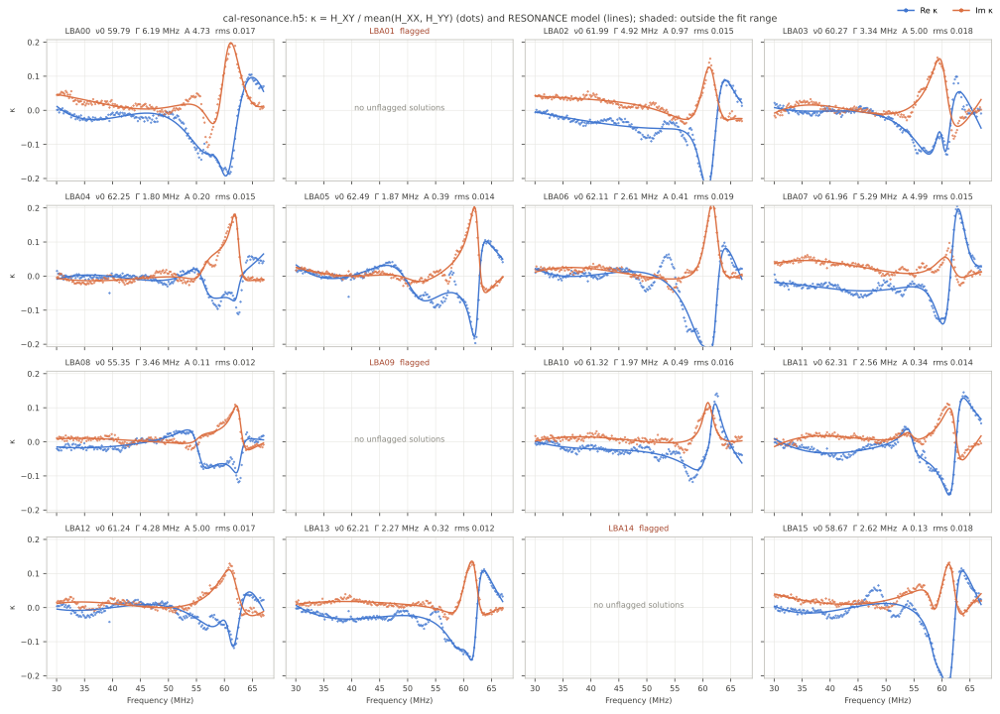
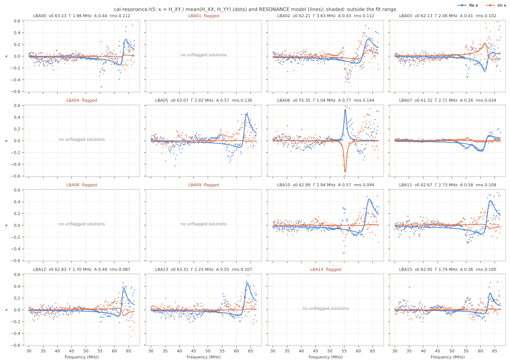
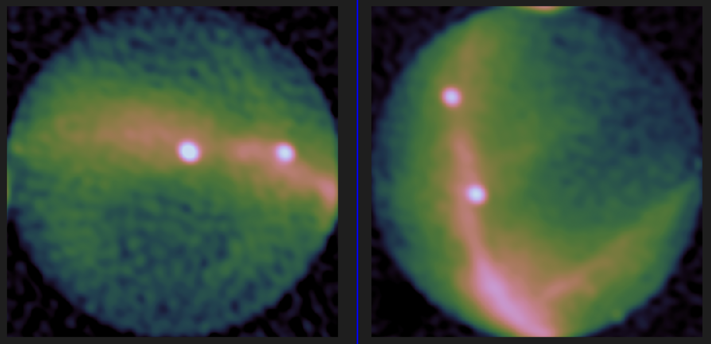

# LOFAR Beam Workshop: Investigation of the LBA Element Resonance

**Authors:** Henrik Edler, Cees Bassa, Michiel Brentjens, Roland Timmerman, based on work by David McKenna

27 Nov 2026

## Conclusions

The XST-to-MS machinery with DP3 and WSClean works well, but the resonance leakage appears to be direction-dependent, so a per-dipole full-Jones correction cannot simply take it out.

- **Methods:** converting XST data to Measurement Sets with `xst2ms` makes single-station LBA data usable with the standard tools. EEP-corrupted prediction, scintillation correction, per-dipole bandpass and full-Jones calibration, imaging and the LoSoTo resonance fit all work on these data.
- **Direction dependence:** assuming the analysis is correct, the leakage caused by the resonance changes with direction on the sky. Two lines of evidence support this (see [Direction dependence](#direction-dependence)):
  1. The fitted resonance shape differs between observations taken with a different sky.
  2. A direction-dependent full-Jones solve gives a different resonance shape for Cas A, Cyg A and the diffuse sky within the same observation.
- **Consequence:** a direction-independent full-Jones solution, or a resonance model fitted to it, only removes a brightness-weighted average of the leakage. This matches the residual Stokes V after applying the resonance model.
- **Caveat:** errors in the LOBES model, or in how it is applied in the prediction, could produce a similar direction-dependent signature.

## Issue

The LOFAR LBA antennas show a pronounced resonance at about 62 MHz. It is seen in single-element data such as cosmic-ray and lightning recordings. After beamforming it also appears in the per-station imaging observations.

For imaging this has two consequences:

1. **Polarization leakage:** strong instrumental leakage in the 57–67 MHz range.
2. **Flux density scale:** the resonance very likely also biases the flux scale in this range.

The resonance is thought to originate in the low-noise amplifier (LNA).

## Data

The experiment uses LOFAR2.0 XST (cross-correlation statistics) data of station CS002LBA. Each dataset is a series of 10 s snapshots, each covering a few subbands, that together span the LBA band.

- **Conversion:** the new script `xst2ms` in [lofarst_scripts](https://github.com/henedler/lofarst_scripts) converts the XST files into Measurement Sets. Each LBA dipole becomes an antenna, so the shortest baseline is 2.55 m and the longest 97 m.
- **Weights:** the script sets the visibility weights from the autocorrelations.
- **Tools:** in MS format the data can be processed with standard tools: DP3 for prediction and solving, WSClean for imaging and LoSoTo for inspecting solutions.

## Sky model and prediction

The model visibilities are the LWA sky model as seen through each LBA dipole's embedded element pattern (EEP).

- **Sky model:** the LWA diffuse sky model from pygdsm, in the implementation by David McKenna.
- **Element patterns:** the LOBES EEPs, also in David McKenna's implementation, which is based on the original MATLAB code. Unlike the current EveryBeam implementation, it should not be affected by the known EveryBeam LOBES bug.
- **Prediction:** `predict_lfsm_ms.py` in [lofarst_scripts](https://github.com/henedler/lofarst_scripts) writes the model into three columns, one per direction, so that the compact sources can be scaled separately later:
  - `MODEL_CASA` and `MODEL_CYGA`: Cas A and Cyg A as point sources.
  - `MODEL_SKY`: the diffuse sky, with the map pixels within 3° of Cas A and Cyg A replaced by the mean within 5°. Both sources use the same elevation cutoff as the diffuse sky (default 5°), so every part of the sky is in exactly one column.
  - `MODEL_DATA_SUM`: the sum of the three.
- **EEP corruption:** each component is multiplied by the EEPs separately, so all columns already include the nominal dipole response.

Any frequency structure left in the calibration solutions is therefore a departure from the LOBES-modelled element response, not the response itself.

## Calibration experiment

The pipeline `calibrate_xst.py` in [lofarst_scripts](https://github.com/henedler/lofarst_scripts) calibrates each dipole in three stages. It first removes the ionospheric scintillation of Cas A and Cyg A from the sky model. It then solves the bandpass and full-Jones terms against this corrected model, and finally fits the resonance.

The diffuse sky does not scintillate, because it is much larger than the Fresnel angle (about 6′ at 50 MHz). The scintillation pattern (about 0.5–1 km) is much larger than the 80 m station, so one factor per source and snapshot applies to all dipoles.

**Pipeline steps.** The scintillation correction follows David McKenna's method. All solves use baselines longer than 15 m.

1. **Predict:** `MODEL_CASA`, `MODEL_CYGA`, `MODEL_SKY` (this is the diffuse sky) and `MODEL_DATA_SUM`, all EEP-corrupted.
2. **Temporary phases:** a scalar phase solve per dipole on DATA against `MODEL_DATA_SUM`, applied to a new column `SCALARPHASE_DATA`. This only makes the data coherent for the next step that solves only for amplitudes.
3. **Scintillation solve:** a direction-dependent scalar amplitude solve on `SCALARPHASE_DATA`, with the three model columns as directions. There is one solution per snapshot (all its channels), and ALL DIPOLES are constrained to the same solution in DP3.
4. **Scaled models:** `MODEL_CASA_SCALED` = `MODEL_CASA` × g_CasA² / g_SKY², and likewise for Cyg A, done with two DP3 applycal steps. Dividing by the diffuse-sky amplitude keeps the snapshot's instrument gain and model flux scale in the data, so the bandpass still sees them.
5. **Corrected model:** `MODEL_DATA_SUM_SCALED` = the two scaled sources + `MODEL_SKY`, with a debug image of the corrected model.
6. **Bandpass:** a diagonal phase and amplitude solve per dipole and channel on DATA against the corrected model. It takes out the X and Y bandpasses, the delays and the residual X–Y phase. The solutions are applied from DATA to CORRECTED_DATA, and a Stokes I and V test image is made.
7. **Full-Jones:** a full-Jones solve per dipole and channel on CORRECTED_DATA against the corrected model, applied to CORRECTED_DATA_FJ, with a second test image.
8. **Resonance fit:** the LoSoTo `RESONANCE` operation on the full-Jones solutions, with two models (next section): a basic one (1 resonance, no background) and an advanced one (2 resonances plus a cubic background).
9. **Apply the resonance models:** each model is applied on its own to the bandpass-corrected data, in place of the full-Jones solutions, and imaged.
10. **Verification:** a new full-Jones solve on the data corrected with each resonance model. If the model captures the resonance, these solutions show no resonance left.
11. **Stokes V statistics:** the net and excess Stokes V flux of all test images, measured per channel within one common mask (elevation ≥ 10°, Stokes I above 5σ in the bandpass image).

The only input is the MS name: `python calibrate_xst.py <MS>`. The script runs these stages as 17 steps. Solutions, plots (`plots-scint`, `plots-bandpass`, `plots-fulljones`, `plots-resonance-basic`, `plots-resonance-advanced`, `plots-verify-<model>`), images and one log per step go to `cal_<MS name>/` next to the MS. Every image step also writes fractional circular polarisation images (V/I) per channel. `--start` and `--stop` run a subset of the steps, and every command is printed as it runs.

In the first run, the per-dipole delays scattered by about ±0.7 ns (about 20 cm of cable). The exception is LBA08, at +5.7 ns, which also has a phase offset of about 105°.

## Resonance fit

A single asymmetric (Fano-type) Lorentzian resonance per dipole describes the resonant leakage with 5–9 parameters instead of about 226 per-channel values; applying it removes the resonance from the leakage solutions completely (see [Verification](#verification)). The fit runs as a new LoSoTo operation, `RESONANCE`, on the full-Jones solutions from step 7.

**What is fitted.** A full-Jones solution against an unpolarised model is only defined up to a unitary rotation common to all dipoles in each channel. The fit therefore uses the part that does not depend on it: the Hermitian part H = (J J^H)^(1/2) of each dipole, normalised to its mean gain. In H, the mean gain and the X/Y gain difference are flat across the resonance. The whole effect sits in the off-diagonal term κ = ε_U − iε_V: a trough at about 61 MHz, a steep zero crossing at about 62.2 MHz and a peak at about 63.6 MHz.

**Model.**

```math
H_i(\nu) \approx g_i(\nu)\begin{pmatrix}1 & \kappa_i(\nu)\\ \kappa_i^*(\nu) & 1\end{pmatrix},\qquad \kappa_i(\nu) = \sum_{j=0}^{N_{\rm bg}} b_{j,i}\,(\nu-\nu_{\rm ref})^j + \sum_{k=1}^{N_{\rm res}} A_{k,i}\,e^{i\psi_{k,i}}\,\frac{\sin\varphi_{k,i} - x_k\cos\varphi_{k,i}}{1+x_k^2},\qquad x_k=\frac{\nu-\nu_{0,k,i}}{\Gamma_{k,i}/2}
```

Each resonance term is the real part of a complex Lorentzian. The shape angle φ mixes its dispersive and absorptive parts and produces the asymmetry; the complex amplitude A e^(iψ) sets its size and phase. A freely complex fit gives the same shape, so this form is sufficient. The complex coefficients b_j form a smooth background leakage of order N_bg (`bgOrder`; −1 means no background). The sign ambiguity between (A, ψ, φ) and (A, ψ+π, φ+π) is fixed so that ψ always lies within ±90°. All parameters are fitted per dipole.

The pipeline fits two models over the whole band:

| Model | Resonances | Background | Free real parameters per dipole |
| --- | --- | --- | --- |
| basic | 1 | none | 5 |
| advanced | 2 | cubic (complex) | 18 |

**How the fit runs.** For each time, direction and dipole, the operation:

1. Builds J from the amplitude and phase soltabs (the phase soltab is found automatically, or set with `soltabPhase`).
2. Takes the Hermitian part H = (J J^H)^(1/2) and forms κ = H_XY / mean(H_XX, H_YY).
3. Fits the model by non-linear least squares within `freqRange` (default above 45 MHz; the pipeline uses the whole band), starting from ν₀ = 62.3 MHz and Γ = 2.6 MHz, with Γ limited to 0.3–10 MHz. With `robust = True` the fit uses a soft-L1 loss that is quadratic up to about 3× the channel-to-channel noise, so single bad channels or snapshots do not pull it.
4. Writes the fitted Jones matrix [[1, κ], [κ*, 1]] for all channels and dipoles to new soltabs. Outside the fit range the background is held constant, not extrapolated. Failed or unselected dipoles get the identity with weight 0.

The output soltabs can be applied directly with DP3 applycal (fulljones). A text file lists, per dipole, the fit status (`ok`, `flagged`, `fewpoints`, `fitfailed`, `nu0atbound`, `gammaatbound`, `highrms`), number of channels, residual rms, and ν₀, Γ, Q, φ, A and ψ with their 1σ errors, plus the background coefficients. Only `ok` fits go into the soltabs. Further options set the number of resonances (`nRes`), the background order (`bgOrder`, `includeBackground`), the minimum number of channels (`minPoints`), a residual threshold for flagging (`maxRms`), starting values and ranges (`nu0Guess`, `gammaGuess`, `nu0Range`, `gammaRange`) and the number of processes (`ncpu`).

The two pipeline parsets (`parsets/losoto-resonance-basic.parset` and `-advanced.parset`):

```
[resonanceBasic]
soltab = sol000/amplitude000
operation = RESONANCE
soltabsOut = [amplitudeResBasic,phaseResBasic]
outFile = resonance_fit_basic.txt
nRes = 1
freqRange = [0,0]
bgOrder = -1
robust = True

[resonanceAdvanced]
soltab = sol000/amplitude000
operation = RESONANCE
soltabsOut = [amplitudeResAdvanced,phaseResAdvanced]
outFile = resonance_fit_advanced.txt
nRes = 2
freqRange = [0,0]
bgOrder = 3
robust = True
```

**Fitted values.** The resonance parameters agree between the first run and two scintillation-corrected observations. L2086017 and L2086026 were run with an earlier pipeline version: 1 resonance plus a linear background, fitted over 45–67 MHz. Values are medians over the dipoles with a good fit, with the 16th–84th percentile range in brackets.

| Parameter | L2086794 (first run, no scintillation correction) | L2086017 | L2086026 |
| --- | --- | --- | --- |
| Dipoles fitted | 88 | 81 of 96 | 88 of 96 |
| ν₀ (MHz) | 62.1 (±0.3) | 62.25 (61.78–62.57) | 61.99 (61.50–62.34) |
| Γ (MHz) | 2.5 (±0.4) | 2.87 (2.28–3.49) | 2.85 (2.36–3.55) |
| Q = ν₀/Γ | ≈ 25 | 21.7 (17.7–27.5) | 21.7 (17.3–26.5) |
| φ (deg) | −147 | 163 | −164 |
| A | 0.27 | 0.27 (0.21–0.33) | 0.22 (0.15–0.30) |
| ψ (deg) | −15 (±18) | −13 (−29 to −7) | −16 (−31 to −8) |
| Residual rms of κ | 0.021 | 0.036 | 0.018 |

- **Centre:** the ±0.3 MHz scatter of ν₀ between dipoles is real. In the first run, fixing ν₀ for all dipoles raised the residual from 0.019 to 0.025.
- **Shape:** φ near 180° means a mostly dispersive profile; with the scintillation removed, the absorptive part is smaller than in the first run.
- **Phase:** ψ ≈ −15° matches the −15° to −20° phase measured directly in the XST cross-correlations, so two independent routes give the same coupling.

**Model comparison.** From the first run as well. For scale, κ itself has an rms of 0.071 and the scatter within one snapshot is about 0.009.

| Model | Free parameters | Residual rms of κ |
| --- | --- | --- |
| 1 resonance, all parameters per dipole | 9 per dipole | 0.021 |
| 1 resonance + weaker 2nd one 1.4 MHz lower (Γ ≈ 3.3 MHz), width and shape shared | 5 global + 9 per dipole | 0.019 |
| 2 resonances, ν₀ also shared | 6 global + 8 per dipole | 0.020 |
| 2 resonances, all parameters per dipole | 14 per dipole | 0.015 |

The recommended model has about 9 real parameters per dipole (ν₀ and complex offset, slope and amplitude), with Γ and φ shared by all dipoles. The second resonance is only needed to describe 55–61 MHz more accurately.

## Verification

Applying the fitted resonance removes the resonance from the leakage solutions completely, but only part of the Stokes V leakage in the images. Both checks use L2086017 and L2086026 with the earlier pipeline version (1 resonance + linear background, 45–67 MHz).

**Leakage solutions.** After applying the resonance model, a new full-Jones solve should find only what the model did not describe. The table gives the rms of κ per dipole over each band, median over dipoles. The channel-to-channel noise of κ is about 0.005.

| Observation | Band (MHz) | Before | Expected after | Measured after |
| --- | --- | --- | --- | --- |
| L2086017 | 45–57 | 0.034 | 0.018 | 0.018 |
| L2086017 | 57–68 | 0.114 | 0.049 | 0.048 |
| L2086026 | 45–57 | 0.033 | 0.017 | 0.018 |
| L2086026 | 57–68 | 0.087 | 0.019 | 0.019 |

The new solutions match the expected residual to within 0.005. The part common to all dipoles drops from 0.155 to 0.041 (L2086017) and from 0.127 to 0.013 (L2086026) at 57–68 MHz. Projected onto the fitted resonance shape, the new solutions contain none of it (median −0.02, where 1 would mean nothing was removed).

**Stokes V in the images.** Net Stokes V as a fraction of Stokes I, within the common mask, for L2086017 / L2086026:

| Frequency (MHz) | Corrected model | Bandpass only | Full-Jones | Resonance model |
| --- | --- | --- | --- | --- |
| 31.4 | −0.03% / −0.04% | 0.59% / 0.80% | −2.93% / −3.90% | 2.62% / 1.83% |
| 56.2 | −0.06% / −0.02% | 2.61% / 2.54% | −0.63% / −0.53% | 0.00% / −0.51% |
| 59.3 | 0.01% / 0.03% | 6.81% / 6.07% | −0.25% / −0.48% | 2.48% / 1.51% |
| 62.4 | 0.22% / 0.26% | 7.93% / 5.37% | −1.31% / −1.50% | 5.72% / 3.26% |
| MFS (48.5) | 0.01% / 0.03% | 1.21% / 0.87% | −1.28% / −1.54% | 2.37% / 1.15% |

- **Resonance band:** with only the bandpass, V reaches 5–8% of I at 59–62 MHz. The full-Jones solutions bring it below 1.5%; the resonance model only to 1.5–5.7%.
- **Below the fit range:** the resonance model adds V at 31 MHz (1.8–2.6%, against 0.6–0.8% with the bandpass only). The fitted background was held constant below 45 MHz, which likely adds leakage there. The current pipeline therefore fits the whole band.
- **Full-Jones:** the per-channel solutions overshoot to negative V at low frequencies (−2.9% to −3.9% at 31 MHz).

**Fractional circular polarisation across the sky.** The V/I images of one observation, processed with the current pipeline, show that none of the four corrections removes the leakage pattern across the sky. Each figure shows V/I per channel and for the MFS image, on a colour scale of ±0.5.

- **All frequencies:** V/I has a large-scale gradient across the sky with a sign change, red on one side and blue on the other, reaching about ±0.3–0.4 towards the horizon. This pattern is present even at 31–47 MHz, far below the resonance, and looks much the same after every correction.
- **Resonance band (56–62 MHz):** the pattern becomes stronger and tilted. The full-Jones solutions and the two resonance models change it compared with the bandpass alone, but none of them flattens it.
- **Interpretation:** a direction-independent correction can only remove the leakage averaged over the sky, so a leakage that changes sign across the sky stays. This supports the direction dependence. The gradient far below the resonance also points to a direction-dependent error that is not the resonance, e.g. in the element-pattern model.



*Figure 1: V/I after the bandpass only (img-bp).*



*Figure 2: V/I after the per-channel full-Jones solutions (img-fj).*



*Figure 3: V/I after the basic resonance model (1 resonance, no background; img-res-basic).*



*Figure 4: V/I after the advanced resonance model (2 resonances, cubic background; img-res-advanced).*

## Direction dependence

The resonance frequency is the same in every direction, but the strength and shape of the resonant leakage and the broadband leakage background change with direction.

**Between observations.** The apparent resonance shape follows the sky. Two October observations with a similar sky (Cas A at about 82° elevation, Cyg A at 48°) give the same shape. The November observation (Cas A at 62°, Cyg A at 26°) gives a different one, and a daytime observation, with the Sun as an extra bright source, differs again. Widening the uv range improves the agreement somewhat, but not enough.

The two figures below show the leakage term κ (dots) and the RESONANCE fit (lines) for the first 16 dipoles of CS002, from two observations taken at different times. In the first, the resonance is a clean, mostly imaginary-part feature at about 60–62 MHz, with fit residuals of 0.012–0.019. In the second, it sits higher, at about 62–63 MHz, appears mainly in the real part, and the solutions are several times noisier (residuals of about 0.1).



*Figure 5: κ = H_XY / mean(H_XX, H_YY) (dots) and the RESONANCE model (lines) for LBA00–LBA15, observation A. Blue: real part, orange: imaginary part.*



*Figure 6: the same for observation B, taken with a different sky. Note the different y-axis range.*

The all-sky images of the two observations show how different the two skies are. In one, Cas A and Cyg A both stand high, near the centre of the image, with the Galactic plane running across it. In the other, both sources are further from the zenith on one side, and the brightest part of the Galactic plane lies near the horizon.



*Figure 7: all-sky Stokes I images of CS002LBA for the two observations shown in Figures 5 and 6.*

**Within one observation.** A direction-dependent full-Jones solve, with the three scaled model columns (Cas A, Cyg A, diffuse sky) as directions, separates the leakage seen towards each source. For the 24 Nov observation (22:05 UTC):

| Direction (elevation) | Resonance | Leakage background below ~55 MHz | Noise |
| --- | --- | --- | --- |
| Cas A (62°) | single sharp peak at ~60–62 MHz in almost every dipole, mostly 0.2–0.4 | ~0.02–0.05 | very clean |
| Diffuse sky | same frequencies, broader and structured, often several bumps at 50–65 MHz | 0.05–0.1 | moderate |
| Cyg A (25°) | visible at ~60 MHz in many dipoles, but irregular | 0.1–0.4, rising towards 30 MHz | spike at 39.6 MHz in almost all dipoles |

- **Resonance frequency:** the same in all three directions. This fits a resonance of the coupled X–Y circuit, i.e. a property of the dipole itself.
- **Strength and shape:** these reach the sky through the cross-polarised part of the element pattern, which depends on direction. Cas A, high in the sky, shows the cleanest resonance. Cyg A, at low elevation, shows much more broadband leakage, as expected since dipole cross-polarisation grows towards the horizon.
- **Diffuse sky:** an average over many directions, so its resonance looks smeared and multi-peaked.
- **Effect on the direction-independent solve:** it sees a brightness-weighted mixture of these directions. A different sky gives a different mixture and thus a different apparent resonance, which explains the differences between observations.

**A possible model.** If this holds up, the leakage could be written as one resonance per dipole, scaled by a complex factor per direction, plus a direction-dependent background:

```math
\kappa(\nu,\,\text{dipole},\,\text{dir}) = G(\text{dir})\,R_{\rm dipole}(\nu) + b(\nu,\,\text{dir})
```

Here R_dipole(ν) carries ν₀, Γ and φ per dipole, and only G and the background change with direction.

**Limitations of this comparison.**

- **Raw solutions:** the comparison so far uses the raw |J_XY| of the direction-dependent solve, which still contains the unitary part. The fair comparison is κ from the Hermitian part, which RESONANCE computes for each direction separately.
- **Model errors per direction:** each direction's solution also absorbs that direction's model errors: its flux scale, its scintillation scaling and, for Cyg A, the element pattern at low elevation.
- **LOBES model:** errors in the LOBES element patterns, or in how they are applied in the prediction, would also be direction-dependent and could mimic this signature.

## Open questions

The main open question is whether the direction dependence is real or caused by the element-pattern model. How much of the resonance also sits in the diagonal bandpass, and therefore in the flux scale, is also still open.

- **Resonance in the bandpass:** if only the X−Y (or X+Y) mode resonates, the diagonal should change by half the leakage term, the same in XX and YY. The prediction is a ripple of about 10–15% (±1 dB) at 61–64 MHz in each dipole's bandpass. With the scintillation removed, the bandpass should now be smooth across snapshots, so this ripple can be tested directly.
- **First comparison:** in the first run, the dipole-to-dipole bandpass variance at 56–67 MHz was about twice that at 45–55 MHz. It correlated only weakly with each dipole's leakage (slope +0.5 instead of the predicted 1, about 20% of the variance explained), but the snapshot jumps were still in the data.
- **Per-direction resonance fit:** run RESONANCE on the direction-dependent full-Jones solutions and check per dipole whether ν₀, Γ and φ agree between Cas A, Cyg A and the diffuse sky, with only A e^(iψ) and the background changing. Repeating this on observations with a different sky would map the leakage as a function of azimuth and elevation.
- **LOBES model:** check whether errors in the LOBES element patterns, or in how they are applied, can produce the observed direction dependence, e.g. by comparing with an independent element-pattern model.
- **Residual Stokes V:** the resonance model removes the resonance from the leakage solutions but leaves 1.5–5.7% V at 59–62 MHz, where full-Jones solutions leave below 1.5%. The direction dependence is the likely cause; the unmodelled unitary part, such as an X–Y phase, may contribute.
- **Basic vs. advanced model:** both models, now fitted over the whole band, still have to be compared on the scintillation-corrected runs, in the verification and in the V statistics.
- **Scintillation iteration:** the scintillation factors are measured before the bandpass, where the 10–20% dipole-to-dipole differences act as noise. Repeating the scintillation solve after the bandpass would show whether one iteration is needed.
- **Unitary part:** the fit models only the Hermitian part of the Jones matrices. A rotation common to all dipoles cannot be determined from these solutions.
- **Band edge:** the data end at 67 MHz, so the high-frequency tail of the resonance is only weakly constrained.
